## Simple interconnection of blocks

We have already seen three basic forms of block diagrams:

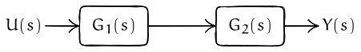{#fig-cascade}

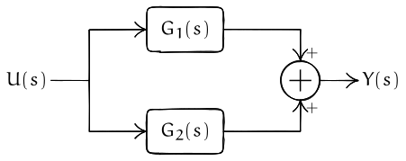{#fig-parallel}

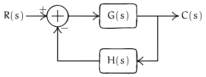{#fig-feedback}

We can use the basic rules above to simplify block diagrams. We provide a few examples below.

:::{#exm-blocks-1}
Simplify the block diagram shown below.

::: {.panel-tabset}

## Original diagram

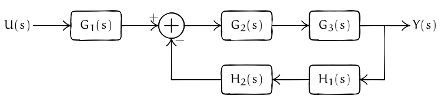

## Step 1

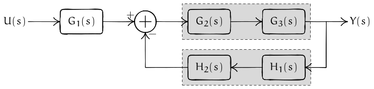

## Step 2

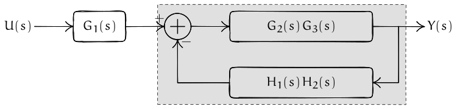

Thus, the simplified TF is

$$
T(s) = \frac{G_1(s) G_2(s) G_3(s) } { 1 + G_1(s) G_2(s) G_3(s) H_1(s) H_2(s) }.
$$

:::
:::

:::{#exm-blocks-2}
Simplify the block diagram shown below.

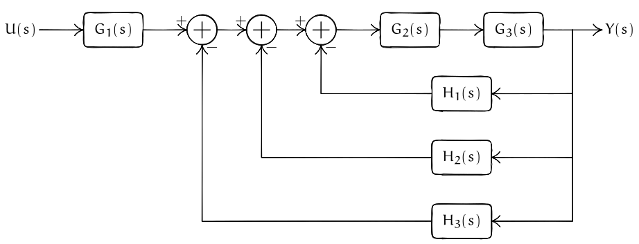
:::

::: {.callout-note}

## Approach 1: Nested feedback loops

::: {.panel-tabset}

## Original diagram

## First feedback loop

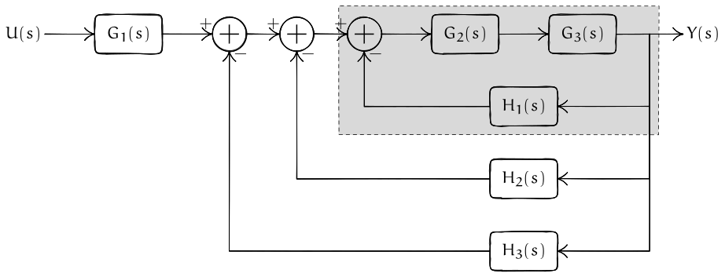

In the first approach, we can view the system as three nested feedback loops. The first loop is highlighted above, which simplifies to

$$
  \dfrac{G_2(s) G_3(s)}{1 + G_2(s) G_3(s) H_1(s)}
$$

## Simplified diagram

## Second feedback loop

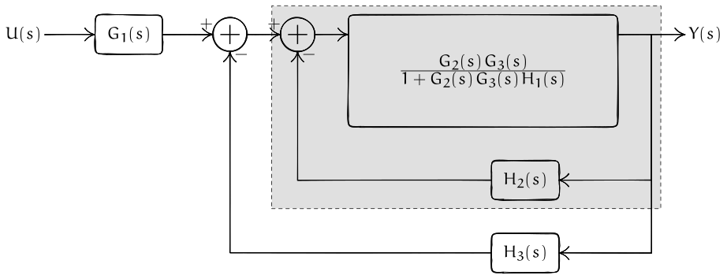

The second loop simplified to

$$
\dfrac{
  \dfrac{G_2(s) G_3(s)}{1 + G_2(s) G_3(s) H_1(s)}
}
{ 1 + 
  \dfrac{G_2(s) G_3(s) H_2(s)}{1 + G_2(s) G_3(s) H_1(s)}
}
= \dfrac{ G_2(s) G_3(s) } { 1 + G_2(s)G_3(s) H_1(s) + G_2(s)G_3(s)H_2(s) }
$$

## Simplified diagram

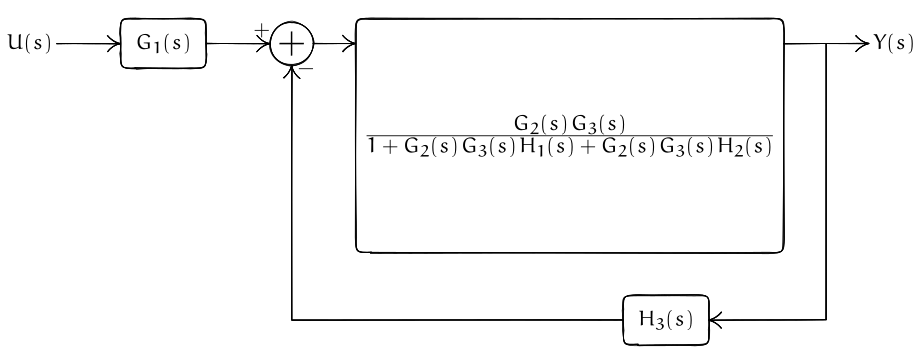

This is a simple feedback loop. Thus, we can simplify it to
$$
\dfrac{ 
 \dfrac{ G_1(s) G_2(s) G_3(s) } { 1 + G_2(s)G_3(s) H_1(s) + G_2(s)G_3(s)H_2(s) }}
{ 1 + 
 \dfrac{ G_1(s) G_2(s) G_3(s) H_3(s) } { 1 + G_2(s)G_3(s) H_1(s) + G_2(s)G_3(s)H_2(s) }
}
= \dfrac{G_1(s) G_2(s) G_3(s) } {1 + G_2(s) G_3(s) \bigl[ H_1(s) + H_2(s) + H_3(s) \bigr] }.
$$
:::
:::

::: {.callout-note}

## Approach 2: Parallel feedback loops

::: {.panel-tabset}

## Original diagram

## Parallel feedback loops

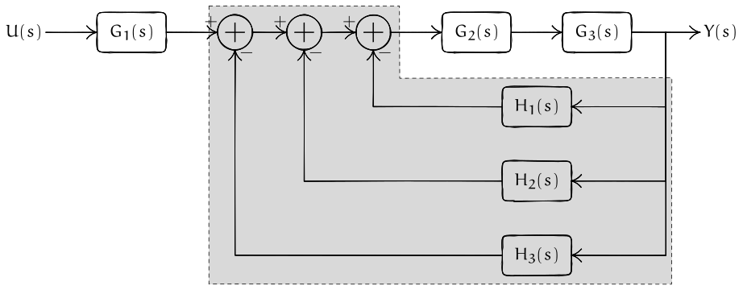

## Simplified diagram

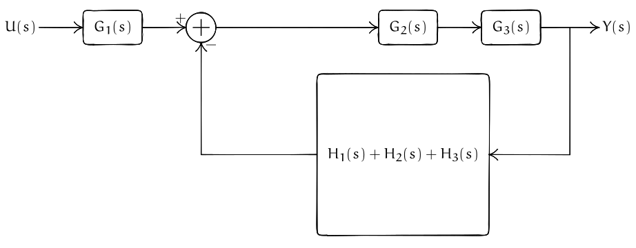

This is a simple feedback circuit. Thus, the simplified transfer function is
$$
\dfrac{G_1(s) G_2(s) G_3(s) } {1 + G_2(s) G_3(s) \bigl[ H_1(s) + H_2(s) + H_3(s) \bigr] }.
$$
:::
:::

The above two examples show that we can simplify block diagrams using the simple rules for interconnected blocks. However, these simple ideas are unable to simplify more complicated block diagrams shown below. 

:::{#exm-blocks-3}
Simplify the block diagram shown below.

:::

In order to simplify such diagrams, we need to develop rules for moving pick up points and adders around blocks.

## Moving pickup points and adders around blocks

There are four basic rules for simplifying block diagrams.

1. **Moving a pickup point after a block to before a block.**
  
   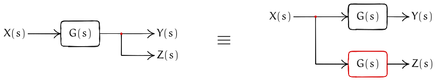

   In both cases, $Y(s) = X(s) G(s)$ and $Z(s) = X(s)G(s)$. 

2. **Moving a pickup point before a block to after a block.**

   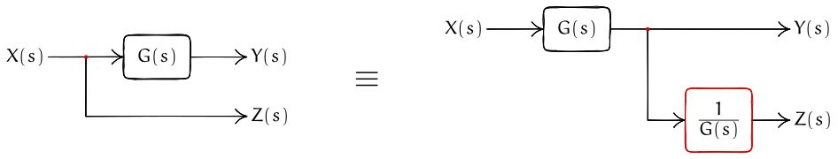

   In both cases, $Y(s) = X(s) G(s)$ and $Z(s) = X(s)$. 

3. **Moving an adder after a block to before a block.**

   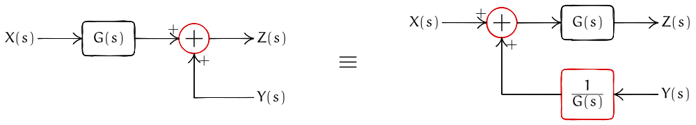

   In both cases, $Z(s) = X(s)G(s) + Y(s)$. 

4. **Moving an adder before a block to after a block.**

   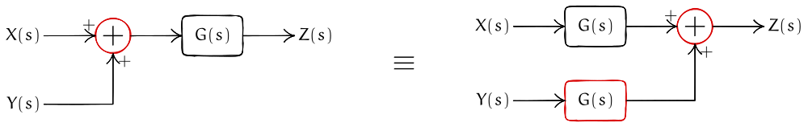

   In both cases, $Z(s) = X(s)G(s) + Y(s)G(s)$. 

## Back to the example

We now see how we can use the rule above to simplify the block diagram of @exm-blocks-3.

::: {.panel-tabset}

## Original diagram

## Moving a pickup point

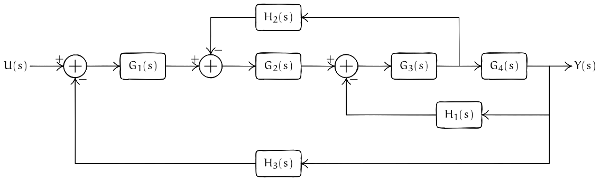

We look at the highlighted sub-block and move the pickup point from behind $G_4(s)$ to after $G_4(s)$. 

## Simplified diagram

:::

The simplified diagram is of the form that we can identify the three basic blocks and iteratively simplify it. However, the method is tedious. We can make it much simpler by moving the adders around so that all of them are in the middle.

::: {.panel-tabset}

## Simplified diagram

## Moving adders

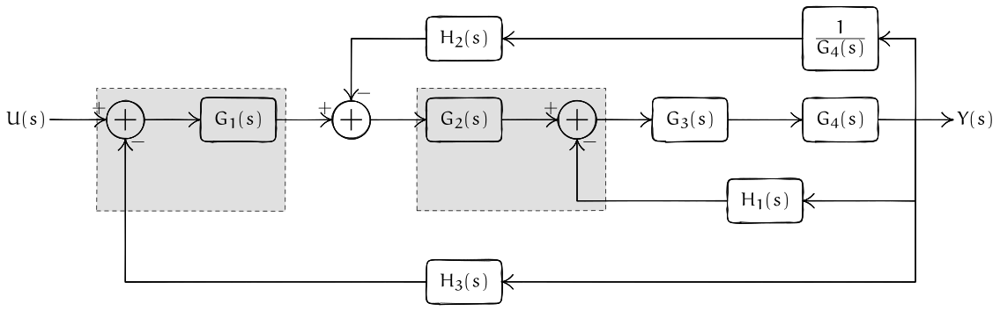

## Simplified diagram

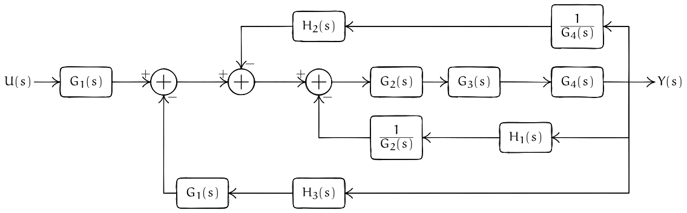

:::

The final diagram now has three adders in feedback, similar to @exm-blocks-2. Therefore, we can simplify the TF as

$$
\dfrac{G_1(s) G_2(s) G_3(s) G_4(s)}
{1 + G_2(s)G_3(s)G_4(s) \Bigl[ \dfrac{H_1(s)}{G_2(s)} + \dfrac{H_2(s)}{G_4(s)} + H_3(s)G_1(s) \Bigr]}.
$$

:::{#exr-block-diagram-practice}
Find the transfer function $Y(s)/R(s)$ for the block diagram below. Keep the answer in terms of the general blocks $G_1(s),G_2(s),G_3(s)$ and $H_1(s),H_2(s)$. The upper path returns the signal before $G_3(s)$ to the positive input of the first summing point; the lower path returns the output through $H_2(s)$.

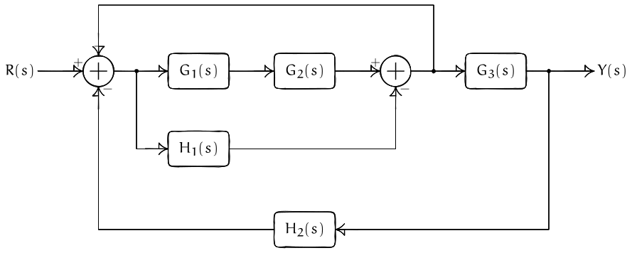{#fig-block-diagram-practice}
:::

## From a transfer function to a block diagram

We can also work in the other direction: start from a transfer function and construct a block diagram using integrators. We first build the controllable canonical form for two orders, then build the observable canonical form for the same transfer functions.

### Controllable canonical form (CCF)

Consider the general second-order, strictly proper transfer function

$$
G(s)=\frac{Y(s)}{U(s)}=\frac{b_1s+b_0}{s^2+a_1s+a_0}.
$$

Dividing numerator and denominator by $s^2$ gives

$$
G(s)=\frac{b_1/s+b_0/s^2}{1+a_1/s+a_0/s^2}.
$$

Let $W(s)$ be the signal entering a pair of cascaded integrators. With zero initial conditions, set $X_2(s)=W(s)/s$ and $X_1(s)=W(s)/s^2$. Then

$$
W(s)=U(s)-a_1X_2(s)-a_0X_1(s),
\qquad
Y(s)=b_1X_2(s)+b_0X_1(s).
$$

The numerator and denominator use the same two integrator signals, so they can share one integrator ladder. The feedback paths implement the denominator, and the output sum implements the numerator.

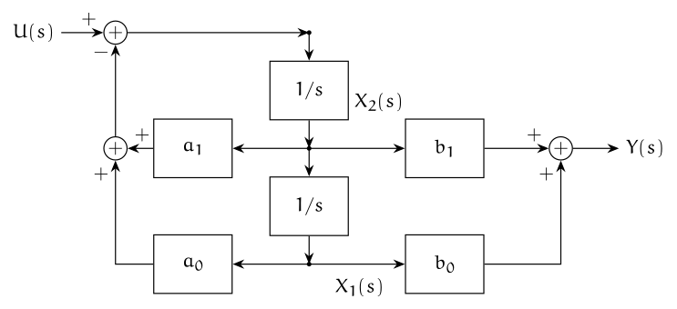{#fig-tf-to-block-ccf}

Now consider a three-integrator ladder for

$$
G(s)=\frac{Y(s)}{U(s)}
=\frac{b_2s^2+b_1s+b_0}{s^3+a_2s^2+a_1s+a_0}.
$$

Dividing by $s^3$ gives numerator terms $b_2/s+b_1/s^2+b_0/s^3$ and denominator terms $1+a_2/s+a_1/s^2+a_0/s^3$. The same three integrator outputs can serve both parts.

Let $W(s)$ enter the ladder, with $X_3(s)=W(s)/s$, $X_2(s)=W(s)/s^2$, and $X_1(s)=W(s)/s^3$. With zero initial conditions, the summing points implement

$$
\begin{aligned}
W(s)&=U(s)-a_2X_3(s)-a_1X_2(s)-a_0X_1(s),\\
Y(s)&=b_2X_3(s)+b_1X_2(s)+b_0X_1(s).
\end{aligned}
$$

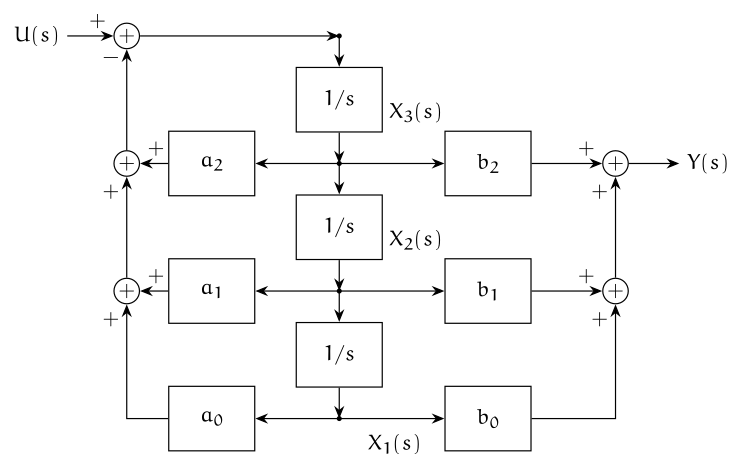{#fig-tf-to-block-ccf-third}

### Observable canonical form (OCF)

For the second-order transfer function above, the observable canonical form has signal equations

$$
\dot x_1(t)=-a_0x_2(t)+b_0u(t),
\qquad
\dot x_2(t)=x_1(t)-a_1x_2(t)+b_1u(t),
\qquad
y(t)=x_2(t).
$$

Integrating each state equation gives a second block diagram for the same input-output relation.

{#fig-tf-to-block-ocf}

For the third-order transfer function, the observable canonical form uses the state equations

$$
\begin{aligned}
\dot x_1(t)&=-a_0x_3(t)+b_0u(t),\\
\dot x_2(t)&=x_1(t)-a_1x_3(t)+b_1u(t),\\
\dot x_3(t)&=x_2(t)-a_2x_3(t)+b_2u(t),\\
y(t)&=x_3(t).
\end{aligned}
$$

Each equation has one summing point followed by an integrator. The output $x_3$ returns through the three denominator gains.

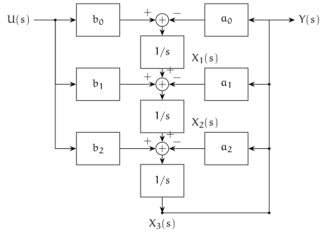{#fig-tf-to-block-ocf-third}

The state variables differ between the CCF and OCF diagrams, although each pair realizes the same transfer function. For the corresponding state-space matrices, see [State space models](state-space-models.qmd).

