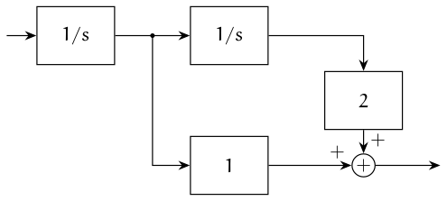
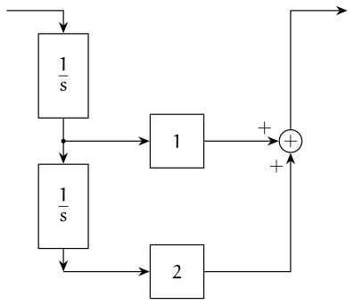
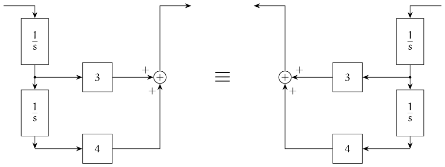
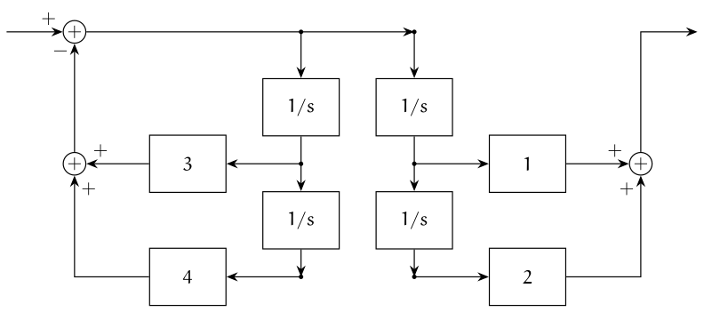
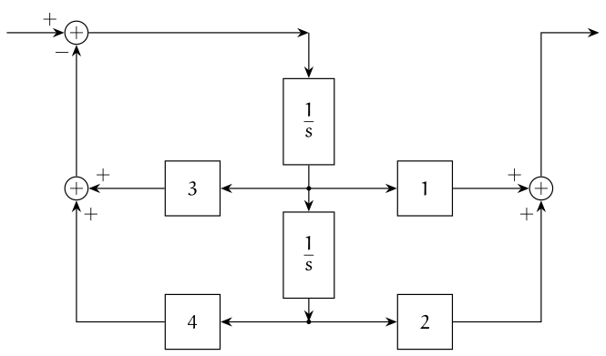

## Simple interconnection of blocks

We have already seen three basic forms of block diagrams:

{#fig-cascade}

{#fig-parallel}

{#fig-feedback}

We can use the basic rules above to simplify block diagrams. We provide a few examples below.

:::{#exm-blocks-1}
Simplify the block diagram shown below.

::: {.panel-tabset}

## Original diagram

## Step 1

## Step 2

Thus, the simplified TF is

$$
T(s) = \frac{G_1(s) G_2(s) G_3(s) } { 1 + G_1(s) G_2(s) G_3(s) H_1(s) H_2(s) }.
$$

:::
:::

:::{#exm-blocks-2}
Simplify the block diagram shown below.

:::

::: {.callout-note}

## Approach 1: Nested feedback loops

::: {.panel-tabset}

## Original diagram

## First feedback loop

In the first approach, we can view the system as three nested feedback loops. The first loop is highlighted above, which simplifies to

$$
  \dfrac{G_2(s) G_3(s)}{1 + G_2(s) G_3(s) H_1(s)}
$$

## Simplified diagram

## Second feedback loop

The second loop simplified to

$$
\dfrac{
  \dfrac{G_2(s) G_3(s)}{1 + G_2(s) G_3(s) H_1(s)}
}
{ 1 + 
  \dfrac{G_2(s) G_3(s) H_2(s)}{1 + G_2(s) G_3(s) H_1(s)}
}
= \dfrac{ G_2(s) G_3(s) } { 1 + G_2(s)G_3(s) H_1(s) + G_2(s)G_3(s)H_2(s) }
$$

## Simplified diagram

This is a simple feedback loop. Thus, we can simplify it to
$$
\dfrac{ 
 \dfrac{ G_1(s) G_2(s) G_3(s) } { 1 + G_2(s)G_3(s) H_1(s) + G_2(s)G_3(s)H_2(s) }}
{ 1 + 
 \dfrac{ G_1(s) G_2(s) G_3(s) H_3(s) } { 1 + G_2(s)G_3(s) H_1(s) + G_2(s)G_3(s)H_2(s) }
}
= \dfrac{G_1(s) G_2(s) G_3(s) } {1 + G_2(s) G_3(s) \bigl[ H_1(s) + H_2(s) + H_3(s) \bigr] }.
$$
:::
:::

::: {.callout-note}

## Approach 2: Parallel feedback loops

::: {.panel-tabset}

## Original diagram

## Parallel feedback loops

## Simplified diagram

This is a simple feedback circuit. Thus, the simplified transfer function is
$$
\dfrac{G_1(s) G_2(s) G_3(s) } {1 + G_2(s) G_3(s) \bigl[ H_1(s) + H_2(s) + H_3(s) \bigr] }.
$$
:::
:::

The above two examples show that we can simplify block diagrams using the simple rules for interconnected blocks. However, these simple ideas are unable to simplify more complicated block diagrams shown below. 

:::{#exm-blocks-3}
Simplify the block diagram shown below.

:::

In order to simplify such diagrams, we need to develop rules for moving pick up points and adders around blocks.

## Moving pickup points and adders around blocks

There are four basic rules for simplifying block diagrams.

1. **Moving a pickup point after a block to before a block.**
  
   

   In both cases, $Y(s) = X(s) G(s)$ and $Z(s) = X(s)G(s)$. 

2. **Moving a pickup point before a block to after a block.**

   

   In both cases, $Y(s) = X(s) G(s)$ and $Z(s) = X(s)$. 

3. **Moving an adder after a block to before a block.**

   

   In both cases, $Z(s) = X(s)G(s) + Y(s)$. 

4. **Moving an adder before a block to after a block.**

   

   In both cases, $Z(s) = X(s)G(s) + Y(s)G(s)$. 

## Back to the example

We now see how we can use the rule above to simplify the block diagram of @exm-blocks-3.

::: {.panel-tabset}

## Original diagram

## Moving a pickup point

We look at the highlighted sub-block and move the pickup point from behind $G_4(s)$ to after $G_4(s)$. 

## Simplified diagram

:::

The simplified diagram is of the form that we can identify the three basic blocks and iteratively simplify it. However, the method is tedious. We can make it much simpler by moving the adders around so that all of them are in the middle.

::: {.panel-tabset}

## Simplified diagram

## Moving adders

## Simplified diagram

:::

The final diagram now has three adders in feedback, similar to @exm-blocks-2. Therefore, we can simplify the TF as

$$
\dfrac{G_1(s) G_2(s) G_3(s) G_4(s)}
{1 + G_2(s)G_3(s)G_4(s) \Bigl[ \dfrac{H_1(s)}{G_2(s)} + \dfrac{H_2(s)}{G_4(s)} + H_3(s)G_1(s) \Bigr]}.
$$

:::{#exr-block-diagram-practice}
Find the transfer function $Y(s)/R(s)$ for the block diagram below. Keep the answer in terms of the general blocks $G_1(s),G_2(s),G_3(s)$ and $H_1(s),H_2(s)$. The upper path returns the signal before $G_3(s)$ to the positive input of the first summing point; the lower path returns the output through $H_2(s)$.

{#fig-block-diagram-practice}
:::

## From a transfer function to a block diagram

There are two ways to implement a transfer function: using differentiators or using integrators. Integrators are cheaper to implement, so we study that method here.

### Motivating example

We illustrate the method via an example. Consider
$$
  G(s) = \frac{s + 2}{s^2 + 3 s + 4}.
$$

We first write the numerator and denominator as polynomials in $1/s$ (multiply both by $1/s^2$):
$$
  G(s) = \frac{ \dfrac 1s + \dfrac 2{s^2} }{ 1 + \dfrac 3s + \dfrac 4{s^2} }
$$
and view this as
$$
  G(s) = \frac{1}{1 + \Bigl[ \dfrac 3s + \dfrac 4{s^2} \Bigr]}
  \cdot \Bigl[ \dfrac 1s + \dfrac 2{s^2} \Bigr].
$$

We will implement both parts separately.

#### The numerator {.unnumbered}

First consider the numerator $\dfrac 1s + \dfrac 2{s^2}$, which can be implemented as

{#fig-tf-to-block-num width=60%}

For reasons that will become clear later, we draw this as follows:

{#fig-tf-to-block-num-ladder width=55%}

#### The denominator {.unnumbered}

We now look at the denominator, $\dfrac{1}{1 + \bigl[ \frac 3s + \frac 4{s^2} \bigr]}$. Note that the term in square brackets has the same form as the numerator. So, we first draw the term in square brackets. We can draw it in either orientation:

{#fig-tf-to-block-bracket}

Now we can implement $1/(1 + [\cdots])$ using feedback.

![Implementation of $1/(1+[\cdots])$ via feedback](figures/svg/tf-to-block4.svg){#fig-tf-to-block-den width=70%}

#### Combining the numerator and denominator {.unnumbered}

Now we combine the numerator and the denominator.

{#fig-tf-to-block-combine}

Note that the two "integrator ladders" have the same voltages (they carry the same signals), so we can combine them.

{#fig-tf-to-block-shared width=75%}

This gives us the general form of the implementation, for
$$
  G(s) = \frac{b_1 s + b_0}{s^2 + a_1 s + a_0}.
$$
The gains in the feedback path are the coefficients of the denominator in reverse order, and the gains in the output path are the coefficients of the numerator in reverse order.

### Controllable canonical form (CCF)

This corresponds to the CCF form of the transfer function.

{#fig-tf-to-block-ccf}

Let's write the equations corresponding to the two integrators, with states $x_1$ (output of the lower integrator) and $x_2$ (output of the upper integrator):
$$
  \dot x_1 = x_2, \qquad
  \dot x_2 = -a_0 x_1 - a_1 x_2 + u,
$$
which can be written in matrix form as
$$
  \begin{bmatrix} \dot x_1 \\ \dot x_2 \end{bmatrix}
  = \begin{bmatrix} 0 & 1 \\ -a_0 & -a_1 \end{bmatrix}
    \begin{bmatrix} x_1 \\ x_2 \end{bmatrix}
  + \begin{bmatrix} 0 \\ 1 \end{bmatrix} u.
$$
Similarly, the output is $y = b_0 x_1 + b_1 x_2$, which can be written as
$$
  y = \begin{bmatrix} b_0 & b_1 \end{bmatrix}
      \begin{bmatrix} x_1 \\ x_2 \end{bmatrix}.
$$

### Observable canonical form (OCF)

We can also implement the OCF form of the transfer function as follows:
$$
  \begin{bmatrix} \dot x_1 \\ \dot x_2 \end{bmatrix}
  = \begin{bmatrix} 0 & -a_0 \\ 1 & -a_1 \end{bmatrix}
    \begin{bmatrix} x_1 \\ x_2 \end{bmatrix}
  + \begin{bmatrix} b_0 \\ b_1 \end{bmatrix} u,
  \qquad
  y = \begin{bmatrix} 0 & 1 \end{bmatrix}
      \begin{bmatrix} x_1 \\ x_2 \end{bmatrix},
$$
which can be expanded as
$$
  \dot x_1 = -a_0 x_2 + b_0 u, \qquad
  \dot x_2 = x_1 - a_1 x_2 + b_1 u, \qquad
  y = x_2.
$$
We implement these equations as follows:

{#fig-tf-to-block-ocf}

Here the gains in the input path are the coefficients of the numerator in reverse order, and the gains in the feedback path are the coefficients of the denominator in reverse order.

### Higher-order transfer functions

The same construction works for any order. As an example, consider
$$
  G(s) = \frac{b_2 s^2 + b_1 s + b_0}{s^3 + a_2 s^2 + a_1 s + a_0}.
$$
Dividing by $s^3$ gives numerator terms $b_2/s + b_1/s^2 + b_0/s^3$ and denominator terms $1 + a_2/s + a_1/s^2 + a_0/s^3$. The same three-integrator ladder serves both. Let $W(s)$ enter the ladder, with $X_3 = W/s$, $X_2 = W/s^2$, $X_1 = W/s^3$. The summing points implement
$$
  W = U - a_2 X_3 - a_1 X_2 - a_0 X_1, \qquad
  Y = b_2 X_3 + b_1 X_2 + b_0 X_1,
$$
which gives the CCF diagram:

{#fig-tf-to-block-ccf-third}

The OCF has the state equations
$$
  \begin{aligned}
  \dot x_1 &= -a_0 x_3 + b_0 u, \\
  \dot x_2 &= x_1 - a_1 x_3 + b_1 u, \\
  \dot x_3 &= x_2 - a_2 x_3 + b_2 u, \\
  y &= x_3,
  \end{aligned}
$$
i.e., each equation is a summing point followed by an integrator, and the output $x_3$ returns through the three denominator gains:

{#fig-tf-to-block-ocf-third}

#### Extending to order $n$

For
$$
  G(s) = \frac{b_{n-1} s^{n-1} + \cdots + b_1 s + b_0}{s^n + a_{n-1} s^{n-1} + \cdots + a_1 s + a_0},
$$
proceed in the same way:

1. Divide the numerator and denominator by $s^n$.
2. **CCF:** draw a ladder of $n$ integrators. The output of the $k$-th integrator from the bottom is $x_k$. Feed back $a_0, \dots, a_{n-1}$ from $x_1, \dots, x_n$ into the input summing point (with negative sign), and combine $b_0, \dots, b_{n-1}$ times $x_1, \dots, x_n$ in the output summing point.
3. **OCF:** use one summing point before each of the $n$ integrators. The $k$-th summing point adds $b_{k-1} u$, $-a_{k-1} x_n$, and (for $k > 1$) $x_{k-1}$. The output is $y = x_n$.

In both cases, the gains appear in the diagram as the coefficients of the numerator and denominator in reverse order. If the transfer function is not strictly proper, first write it as a constant plus a strictly proper part; the constant is a direct (feed-through) path from $U$ to $Y$.

For the corresponding state-space matrices, see [State space models](state-space-models.qmd).
