## Plan

In this lecture, we

1. learn how to sketch the **Nyquist plot** of a transfer function,
2. use **Cauchy's argument principle** to count the closed-loop poles in the ORHP,
3. state the **Nyquist stability criterion** and use it to find the range of gains $K$ for which the closed loop is stable, and
4. handle open-loop poles on the $jω$-axis.

## Nyquist plots {.divider .center}

## Two ways to plot the frequency response

::: {.columns}
::: {.column width="48%"}
- **Bode plot:** $|G(jω)|$ and $\angle G(jω)$ versus $ω$, as two separate plots.

- **Nyquist plot:** a parametric polar plot of the complex number $G(jω)$.

::: {.fragment}
- We plot it for **all** $ω \in (-∞, ∞)$ and draw an arrow in the direction of increasing $ω$.

- For a real impulse response, $G(-jω) = \overline{G(jω)}$. So the part for $ω < 0$ is the **mirror image** about the real axis of the part for $ω > 0$.
:::
:::

::: {.column width="52%"}
```{ojs}
nyquistPlot({num: [1], den: [1, 1, 1]}, {
  x: [-0.7, 1.3], y: [-1.25, 1.25], width: 420, arrows: [0.4, 1.4]
})
```

[Nyquist plot of $G(s) = \dfrac{1}{s^2 + s + 1}$. Solid: $ω > 0$; dashed: $ω < 0$.]{.plot-legend}
:::
:::

```{ojs}
//| output: false

// ---- Complex arithmetic on [re, im] pairs ----
cmul = (a, b) => [a[0] * b[0] - a[1] * b[1], a[0] * b[1] + a[1] * b[0]]
cdiv = (a, b) => {
  const d = b[0] * b[0] + b[1] * b[1]
  return [(a[0] * b[0] + a[1] * b[1]) / d, (a[1] * b[0] - a[0] * b[1]) / d]
}

// Polynomial with real coefficients (highest power first) evaluated at complex s
polyval = (p, s) => p.reduce((acc, c) => { const t = cmul(acc, s); return [t[0] + c, t[1]] }, [0, 0])
polymul = (...ps) => ps.reduce((a, b) => {
  const r = Array(a.length + b.length - 1).fill(0)
  a.forEach((x, i) => b.forEach((y, j) => { r[i + j] += x * y }))
  return r
})
tfval = (G, s) => cdiv(polyval(G.num, s), polyval(G.den, s))

// ---- Frequency response on a log grid, plus its mirror image ----
nyquistData = (G, {wmin = 1e-4, wmax = 1e3, n = 3000} = {}) => {
  const pos = Array.from({length: n}, (_, i) => {
    const w = wmin * Math.pow(wmax / wmin, i / (n - 1))
    const z = tfval(G, [0, w])
    return {w, re: z[0], im: z[1]}
  })
  const neg = pos.map(d => ({w: -d.w, re: d.re, im: -d.im})).reverse()
  return {pos, neg}
}

// Direction markers: a triangle at G(jω), rotated along dG/dω
arrowAt = (G, w) => {
  const h = 1e-5 * Math.max(1, Math.abs(w))
  const z = tfval(G, [0, w])
  const a = tfval(G, [0, w + h]), b = tfval(G, [0, w - h])
  const theta = Math.atan2(a[1] - b[1], a[0] - b[0]) * 180 / Math.PI
  return {re: z[0], im: z[1], rot: 90 - theta}
}

nyquistBlue = "#0d6efd"
criticalRed = "#dc3545"

nyquistPlot = (G, opts = {}) => {
  const {pos, neg} = nyquistData(G, opts)
  const ws = opts.arrows ?? []
  const arrows = ws.flatMap(w => [arrowAt(G, w), arrowAt(G, -w)])
  return Plot.plot({
    width: opts.width ?? 480,
    aspectRatio: 1,
    x: {domain: opts.x, label: "Re", labelAnchor: "right", ticks: opts.xticks ?? 5},
    y: {domain: opts.y, label: "Im", labelAnchor: "top", ticks: opts.yticks ?? 5},
    clip: true,
    grid: true,
    style: {fontSize: "14px", background: "transparent"},
    marks: [
      Plot.ruleX([0], {stroke: "#adb5bd"}),
      Plot.ruleY([0], {stroke: "#adb5bd"}),
      ...(opts.under ?? []),
      Plot.line(neg, {x: "re", y: "im", stroke: nyquistBlue, strokeWidth: 2,
                      strokeDasharray: "6,4", strokeOpacity: 0.7}),
      Plot.line(pos, {x: "re", y: "im", stroke: nyquistBlue, strokeWidth: 2.5,
                      channels: {"ω": "w"},
                      tip: {format: {x: ".3f", y: ".3f", "ω": ".3g"}}}),
      Plot.dot(arrows, {x: "re", y: "im", rotate: "rot", symbol: "triangle",
                        fill: nyquistBlue, r: 6}),
      // Critical point -1 + j0 as a red "+", shown only when asked for (as in the notes)
      ...(opts.critical ?
          [Plot.dot([{re: -1, im: 0}], {x: "re", y: "im", symbol: "plus",
                                         stroke: criticalRed, strokeWidth: 3, r: 7})] : []),
      ...(opts.extra ?? [])
    ]
  })
}
```

## First-order system

::: {.columns}
::: {.column width="52%"}
$$ G(s) = K \frac{a}{s + a} $$

From the Bode plot:

::: {.limits}
|            | $\lvert G(jω) \rvert$ | $\angle G(jω)$ |
|:-----------|:---------------------:|:--------------:|
| $ω \to 0$  | $K$                   | $0^∘$          |
| $ω \to ∞$  | $0$                   | $-90^∘$        |
:::

::: {.fragment}
- Starts at $(K, 0)$ and moves into the lower half-plane.
- Reaches the origin **tangent to the imaginary axis**, without crossing the axes on the way.
:::
:::

::: {.column width="48%"}
```{ojs}
nyquistPlot({num: [10], den: [1, 2]}, {
  x: [-1.5, 6], y: [-3.75, 3.75], width: 470, arrows: [1, 6]
})
```

[$G(s) = 5 ⋅ \dfrac{2}{s + 2}$, so $K = 5$ and $a = 2$.]{.plot-legend}
:::
:::

## Second-order system with a pole at the origin

::: {.columns}
::: {.column width="58%"}
$$ G(s) = \frac{K}{s} ⋅ \frac{a}{s + a} $$

::: {.limits}
|            | $\lvert G(jω) \rvert$ | $\angle G(jω)$ |
|:-----------|:---------------------:|:--------------:|
| $ω \to 0$  | $∞$                   | $-90^∘$        |
| $ω \to ∞$  | $0$                   | $-180^∘$       |
:::

::: {.fragment}
- As $ω \to 0^+$, the plot goes to $-j∞$, asymptotic to the line $\operatorname{Re} G(jω) = -K/a$.
- As $ω \to ∞$, it reaches the origin **tangent to the real axis**.
:::
:::

::: {.column width="42%"}
```{ojs}
nyquistPlot({num: [10], den: [1, 2, 0]}, {
  x: [-6, 3], y: [-7.5, 7.5], width: 340, arrows: [0.8, 2.5],
  under: [Plot.ruleX([-2.5], {stroke: "#6c757d", strokeDasharray: "2,4"})]
})
```

[$G(s) = \dfrac{5 ⋅ 2}{s(s + 2)}$; dotted line: $\operatorname{Re} = -K/a = -2.5$.]{.plot-legend}
:::
:::

## Higher-order systems

::: {.columns}
::: {.column width="40%"}
```{ojs}
nyquistPlot({num: [30], den: polymul([1, 0], [1, 2], [1, 3])}, {
  x: [-5.5, 1.5], y: [-6, 6], width: 270, arrows: [0.8, 1.5]
})
```

[$G(s) = \dfrac{5 ⋅ 2 ⋅ 3}{s(s + 2)(s + 3)}$]{.plot-legend}
:::

::: {.column width="60%"}
```{ojs}
nyquistPlot({num: [100], den: polymul([1, 1], [1, 2], [1, 2.5])}, {
  x: [-7, 21], y: [-15, 15], width: 430, arrows: [0.6, 2.2], xticks: 6
})
```

[$G(s) = \dfrac{5 ⋅ 2 ⋅ 10}{(s + 1)(s + 2)(s + 2.5)}$]{.plot-legend}
:::
:::

## From Nyquist plots to closed-loop stability {.divider .center}

## Closed-loop stability

{fig-align="center" width="45%"}

Dropping the argument $(s)$, the closed-loop transfer function is
$$ T = \frac{G}{1 + GH}. $$

::: {.fragment}
$T$ is stable $\iff$ $T$ has no poles in the ORHP $\iff$ $1 + GH$ has no **zeros** in the ORHP.
:::

::: {.fragment .keybox}
We can determine the stability of $T$ if we know the number of zeros of $1 + GH$ in the ORHP.
:::

## The poles of $1 + GH$ are the poles of $GH$

Write $G = N_G / D_G$ and $H = N_H / D_H$.

::: {.fragment}
Then
$$ GH = \frac{N_G N_H}{D_G D_H} \quad\text{and}\quad 1 + GH = \frac{D_G D_H + N_G N_H}{D_G D_H}. $$

So $1 + GH$ and $GH$ have the same poles, and in particular the same number of poles in the ORHP.
:::

::: {.fragment .keybox}
**Question:** If we know the number of **poles** of $1 + GH$ in the ORHP, can we find the number of **zeros** of $1 + GH$ in the ORHP?

[The answer is yes, via **Cauchy's argument principle**.]{.text-primary}
:::

## Cauchy's argument principle {.divider .center}

## A transfer function maps $\mathbb{C}$ to $\mathbb{C}$

The transfer function $G(s) = \dfrac{s + 1}{s + 2}$ maps each point of the $s$-plane to a point of the $G$-plane. For example, $G(-1 + j) = \dfrac{j}{1 + j} = \dfrac{1 + j}{2}$.

::: {.columns}
::: {.column width="28%"}
```{ojs}
viewof sigma = Inputs.range([-3, 1], {step: 0.1, value: -1, label: "σ", width: 300})
viewof omega = Inputs.range([-2, 2], {step: 0.1, value: 1, label: "ω", width: 300})
```

```{ojs}
mapG = ({num: [1, 1], den: [1, 2]})
sPoint = [sigma, omega]
GPoint = {
  const d = polyval(mapG.den, sPoint)
  return Math.hypot(d[0], d[1]) < 1e-9 ? null : tfval(mapG, sPoint)
}
fmtC = z => `${z[0].toFixed(2)} ${z[1] < 0 ? "−" : "+"} j${Math.abs(z[1]).toFixed(2)}`
html`<div class="ojs-readout">s = ${fmtC(sPoint)}<br>G(s) = ${GPoint ? fmtC(GPoint) : "∞ (pole)"}</div>`
```
:::

::: {.column width="36%"}
```{ojs}
planePlot(
  [Plot.dot([[-2, 0]], {symbol: "times", stroke: "black", strokeWidth: 2, r: 6}),
   Plot.dot([[-1, 0]], {stroke: "black", strokeWidth: 2, r: 5}),
   Plot.dot([sPoint], {fill: nyquistBlue, r: 6})],
  [-3, 1.5], [-2.25, 2.25]
)
```

[$s$-plane: zero ($○$) at $-1$, pole ($×$) at $-2$]{.plot-legend}
:::

::: {.column width="36%"}
```{ojs}
planePlot(
  GPoint ? [Plot.dot([GPoint], {fill: nyquistBlue, r: 6})] : [],
  [-2.25, 2.25], [-2.25, 2.25]
)
```

[$G$-plane]{.plot-legend}

```{ojs}
//| output: false
planePlot = (marks, xd, yd) => Plot.plot({
  width: 400, aspectRatio: 1, grid: true, clip: true,
  x: {domain: xd, label: null}, y: {domain: yd, label: null},
  style: {fontSize: "13px", background: "transparent"},
  marks: [Plot.ruleX([0], {stroke: "#adb5bd"}), Plot.ruleY([0], {stroke: "#adb5bd"}), ...marks]
})
```
:::
:::

## Curves map to curves

Away from its poles, $G$ is continuous. So a curve in the $s$-plane that does not pass through a pole of $G$ is mapped to a curve in the $G$-plane.

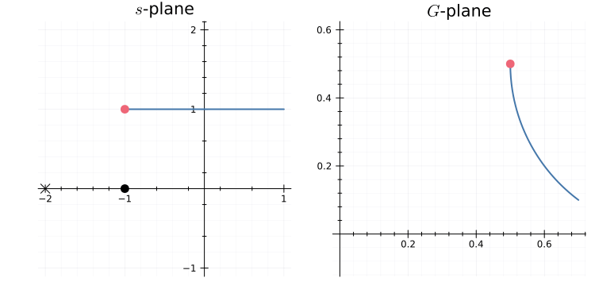{.anim}

::: {.caption}
$G(s) = \dfrac{s + 1}{s + 2}$; the zero ($○$) is at $-1$ and the pole ($×$) is at $-2$.
:::

## Contours map to contours

A curve that starts and ends at the same point is called a **contour**. By convention, contours in the $s$-plane are traversed **clockwise**.

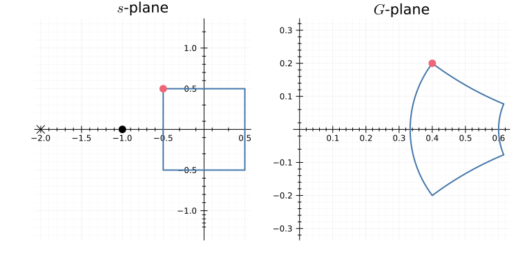{.anim}

::: {.fragment .center-block}
The contour encloses no poles or zeros. Its image is also clockwise and does **not** encircle the origin.
:::

## A contour that encloses a zero

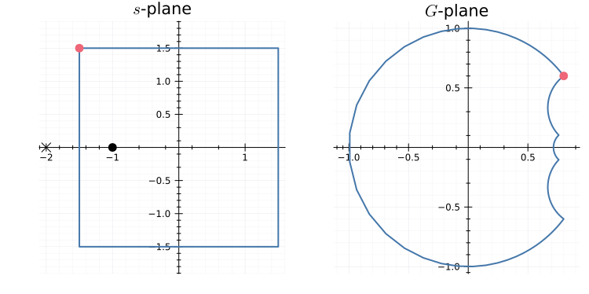{.anim}

::: {.center-block}
How many times does the image encircle the origin, and in which direction?

[One **clockwise** encirclement of the origin.]{.fragment .text-primary}
:::

## A contour that encloses a zero and a pole

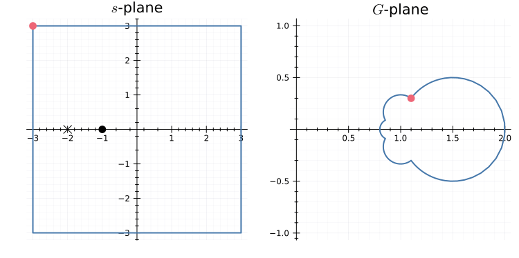{.anim}

::: {.center-block}
How many times does the image encircle the origin, and in which direction?

[**No** encirclement of the origin.]{.fragment .text-primary}
:::

## A contour that encloses a pole

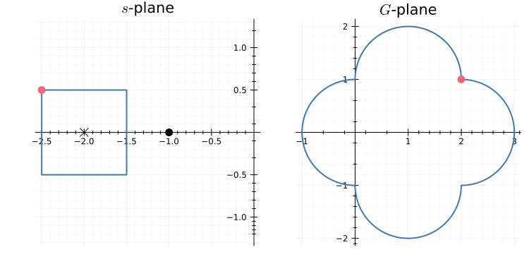{.anim}

::: {.center-block}
How many times does the image encircle the origin, and in which direction?

[One **counter-clockwise** encirclement of the origin.]{.fragment .text-primary}
:::

## Cauchy's argument principle

::: {.callout-tip}
#### Cauchy's argument principle

$$ N = Z - P $$

- $N$: number of **clockwise** encirclements of the origin in the $G$-plane (counter-clockwise encirclements count as negative)
- $Z$: number of zeros of $G$ inside the contour in the $s$-plane
- $P$: number of poles of $G$ inside the contour in the $s$-plane
:::

::: {.fragment .compact}
| Contour encloses | $N$ | $Z$ | $P$ |
|:-----------------|:---:|:---:|:---:|
| nothing                   | $0$  | $0$ | $0$ |
| the zero at $-1$          | $1$  | $1$ | $0$ |
| the zero at $-1$ and the pole at $-2$ | $0$  | $1$ | $1$ |
| the pole at $-2$          | $-1$ | $0$ | $1$ |
:::

## The Nyquist stability criterion {.divider .center}

## The Nyquist contour

::: {.columns}
::: {.column width="25%"}
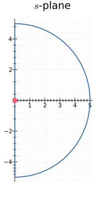{.anim}
:::

::: {.column width="75%"}
- Go up the $jω$-axis from $0$ to $jR$.
- Go clockwise along a semicircle of radius $R$ to $-jR$.
- Go up the $jω$-axis from $-jR$ back to $0$.

::: {.fragment}
As $R \to ∞$, this contour encloses the **entire ORHP**.
:::

::: {.fragment}
The image of the $jω$-axis is $G(jω)$ for $ω \in (-∞, ∞)$, which is **precisely the Nyquist plot of $G$**. For a proper $G$, the image of the large semicircle collapses to the single point $\lim_{s \to ∞} G(s)$.
:::
:::
:::

## The Nyquist plot of $1 + GH$

Take $G(s) = \dfrac{1}{s + 2}$ and $H(s) = 1$, and map the Nyquist contour through $1 + GH$.

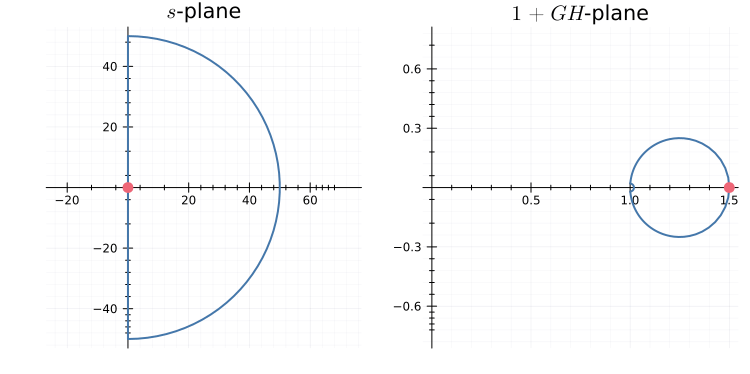{.anim}

::: {.caption}
The small "kink" near $1 + j0$ is the image of the semicircle of radius $R$. It collapses to a point as $R \to ∞$.
:::

## Applying the argument principle to $1 + GH$ {.boxmath}

With the Nyquist contour and the function $1 + GH$, Cauchy's argument principle gives
$$
  \bbox[5pt,border: 1px solid]
  {\begin{array}{@{}c@{}}
  \text{Zeros of $1 + GH$} \\
  \text{in ORHP}
  \end{array}} =
  \bbox[5pt,border: 1px solid]
  {\begin{array}{c}
  \text{Number of clockwise} \\
  \text{encirclements of origin}\\
  \text{in NP of $1 + GH$}
  \end{array}}
  + \bbox[5pt,border: 1px solid]
  {\begin{array}{c}
  \text{Number of poles} \\
  \text{of $1+GH$}\\
  \text{in the ORHP}
  \end{array}}
$$

::: {.fragment}
If we know the number of poles of $1 + GH$ in the ORHP, this answers our original question.

The only catch is that we need to draw the Nyquist plot of $1 + GH$ rather than that of $GH$.
:::

## From $1 + GH$ back to $GH$ {.boxmath}

The Nyquist plot of $1 + GH$ is the Nyquist plot of $GH$ **shifted by $1$**. Therefore,
$$
  \bbox[5pt,border: 1px solid]
  {\begin{array}{@{}c@{}}
  \text{Number of clockwise encirclements}\\
  \text{of \textbf{origin} in the} \\
  \text{Nyquist plot of $1 + GH$}
  \end{array}} =
  \bbox[5pt,border: 1px solid]
  {\begin{array}{@{}c@{}}
  \text{Number of clockwise encirclements}\\
  \text{of $\boldsymbol{-1 + j0}$ in the} \\
  \text{Nyquist plot of $GH$}
  \end{array}}
$$

::: {.fragment}
Moreover, we have already shown that
$$
  \bbox[5pt,border: 1px solid]
  {\begin{array}{@{}c@{}}
  \text{Zeros of $1 + GH$} \\
  \text{in ORHP}
  \end{array}} =
  \bbox[5pt,border: 1px solid]
  {\begin{array}{@{}c@{}}
  \text{Number of poles} \\
  \text{of $T$ in ORHP}
  \end{array}}
  \quad\text{and}\quad
  \bbox[5pt,border: 1px solid]
  {\begin{array}{c}
  \text{Number of poles} \\
  \text{of $1+GH$}\\
  \text{in the ORHP}
  \end{array}} =
  \bbox[5pt,border: 1px solid]
  {\begin{array}{@{}c@{}}
  \text{Number of poles}\\
  \text{of $GH$ in ORHP}
  \end{array}}
$$
:::

## The Nyquist stability criterion

::: {.callout-tip}
#### Nyquist formula

$$ Z = N + P $$

- $Z$: number of zeros of $1 + GH$ in the ORHP, which equals the number of poles of $T$ in the ORHP
- $N$: number of clockwise encirclements of $-1$ by the Nyquist plot of $GH$
- $P$: number of poles of $GH$ in the ORHP
:::

::: {.fragment}
**Procedure**

1. Count the poles of $GH$ in the ORHP (e.g., by [Routh-Hurwitz](https://adityam.github.io/linear-systems/routh-hurwitz.html)) to get $P$.
2. Count the clockwise encirclements of $-1$ by the Nyquist plot of $GH$ to get $N$.
3. Then $Z = N + P$ is the number of poles of $T$ in the ORHP.
4. The closed loop is stable if and only if $Z = 0$, i.e., $N = -P$.
:::

## Examples {.divider .center}

## Example 1

$$ GH(s) = \frac{K}{(s - 2)(s + 6)(s + 8)} $$

::: {.fragment}
- $GH$ has one pole in the ORHP (at $s = 2$), so $P = 1$.
- For stability ($Z = 0$), we need $N = -1$.
- So the Nyquist plot must encircle $-1$ **once counter-clockwise**.
:::

::: {.fragment}
We look at the Nyquist plot for $K = 50$, $100$, $336$, and $500$.
:::

## Example 1: $K = 50$

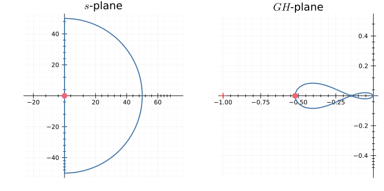{.anim}

::: {.fragment .center-block}
No encirclement of $-1$, so $N = 0$ and $Z = N + P = 1$. [Unstable.]{.text-danger}
:::

## Example 1: $K = 100$

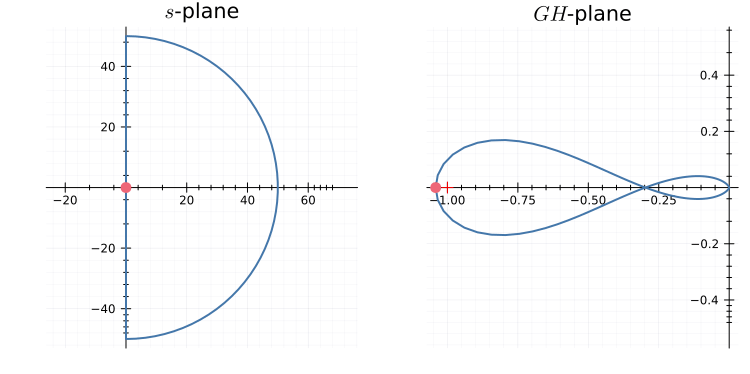{.anim}

::: {.fragment .center-block}
One counter-clockwise encirclement of $-1$, so $N = -1$ and $Z = N + P = 0$. [Stable.]{.text-success}
:::

## Example 1: $K = 336$

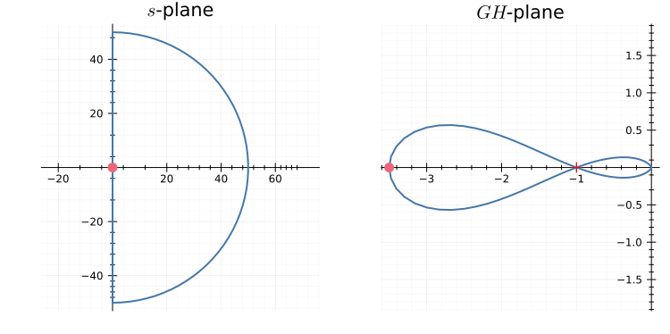{.anim}

::: {.fragment .center-block}
The plot passes **through** $-1$, so $1 + GH$ has zeros on the $jω$-axis (at $±j\sqrt{20}$). [Marginally stable.]{.text-secondary}
:::

## Example 1: $K = 500$

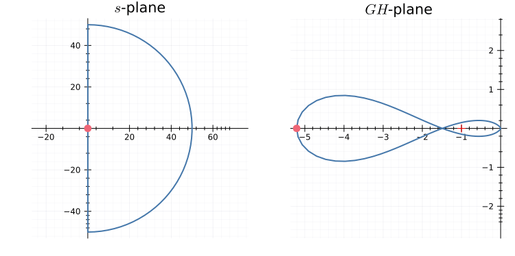{.anim}

::: {.fragment .center-block}
One clockwise encirclement of $-1$, so $N = 1$ and $Z = N + P = 2$. [Unstable.]{.text-danger}
:::

::: {.fragment .center-block .text-small}
Routh-Hurwitz on $s^3 + 12 s^2 + 20 s + (K - 96)$ confirms that the closed loop is stable exactly when $96 < K < 336$.
:::

## Example 2

$$ GH(s) = K \frac{(s + 1)(s + 2)}{(s - 3)(s - 4)} $$

::: {.fragment}
- $GH$ has two poles in the ORHP (at $s = 3$ and $s = 4$), so $P = 2$.
- For stability ($Z = 0$), we need $N = -2$.
- So the Nyquist plot must encircle $-1$ **twice counter-clockwise**.
:::

## Example 2: $K = 1$

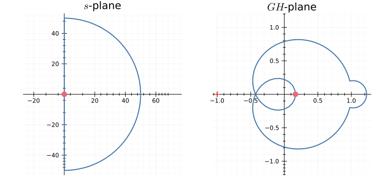{.anim}

::: {.caption}
The kink near $1 + j0$ in the $GH$-plane becomes a point as $R \to ∞$ in the $s$-plane.
:::

::: {.fragment .center-block}
No encirclement of $-1$, so $N = 0$ and $Z = N + P = 2$. [Unstable.]{.text-danger}
:::

## Example 2: $K = 10$

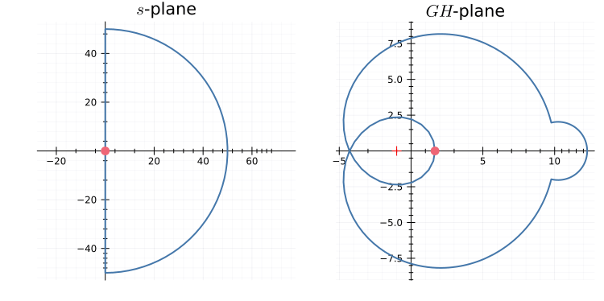{.anim}

::: {.fragment .center-block}
Two counter-clockwise encirclements of $-1$, so $N = -2$ and $Z = N + P = 0$. [Stable.]{.text-success}
:::

::: {.fragment .center-block .text-small}
Routh-Hurwitz on $(1 + K) s^2 + (3K - 7) s + (12 + 2K)$ confirms that the closed loop is stable exactly when $K > 7/3$.
:::

## Values of the gain $K$ for stability {.divider .center}

## Varying the gain without redrawing

Write $GH(s) = K\, L(s)$. The Nyquist plot of $GH$ is that of $L$ scaled by $K$, and
$$ K L(jω) = -1 \iff L(jω) = -\frac{1}{K}. $$

::: {.fragment}
Hence
$$
  \begin{pmatrix} \text{CW encirclements of } -1 \\ \text{by the Nyquist plot of } K L \end{pmatrix}
  = \begin{pmatrix} \text{CW encirclements of } -1/K \\ \text{by the Nyquist plot of } L \end{pmatrix}.
$$
This also holds for $K < 0$, because a $180^∘$ rotation preserves orientation.
:::

::: {.fragment .keybox}
Draw the Nyquist plot **once** (for $K = 1$) and count the encirclements of $-1/K$.
:::

## Example 3

::: {.columns}
::: {.column width="55%"}
$$ GH(s) = \frac{K}{(s + 1)(s + 2)} $$

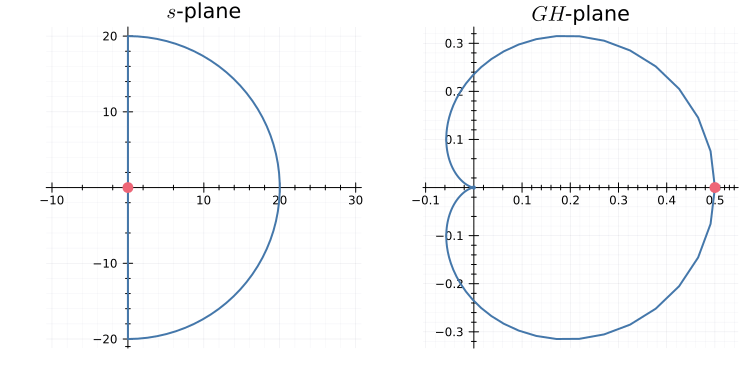{.anim .anim-small}

::: {.caption}
Nyquist plot for $K = 1$. It meets the real axis at $0$ and $1/2$.
:::
:::

::: {.column width="45%"}
$P = 0$, so stability needs $N = 0$.

::: {.compact}
| Location of $-1/K$ | $K$ | $N$ | Stable? |
|:--:|:--:|:--:|:--:|
| [$(-∞, 0)$]{.fragment data-fragment-index="1"} | [$(0, ∞)$]{.fragment data-fragment-index="1"} | [$0$]{.fragment data-fragment-index="2"} | [Yes]{.fragment data-fragment-index="3"} |
| [$\left(0, \tfrac 12\right)$]{.fragment data-fragment-index="4"} | [$(-∞, -2)$]{.fragment data-fragment-index="4"} | [$1$]{.fragment data-fragment-index="5"} | [No]{.fragment data-fragment-index="6"} |
| [$\left(\tfrac 12, ∞\right)$]{.fragment data-fragment-index="7"} | [$(-2, 0)$]{.fragment data-fragment-index="7"} | [$0$]{.fragment data-fragment-index="8"} | [Yes]{.fragment data-fragment-index="9"} |
:::

::: {.fragment data-fragment-index="10"}
Stable for $K > 0$ or $K \in (-2, 0)$.
:::
:::
:::

## Example 3: slide the critical point $-1/K$

::: {.columns}
::: {.column width="42%"}
$$ GH(s) = \frac{K}{(s + 1)(s + 2)} $$

```{ojs}
viewof crit3 = gainSlider(gainExamples.ex3)
```

```{ojs}
gainReadout(gainExamples.ex3, crit3)
```
:::

::: {.column width="58%"}
```{ojs}
gainPlot(gainExamples.ex3, crit3)
```

[Nyquist plot of $L$ (that is, $K = 1$); the red $+$ is $-1/K$.]{.plot-legend}
:::
:::

```{ojs}
//| output: false
// Shared by the three "slide the critical point" slides.
// Write GH = K L. The slider sets c = -1/K and ranges over the plot window,
// which contains every real-axis crossing, so every row of the case table is reachable.
// c0 is a stable starting point.
closedNyquistCurve = L => {
  // Closed polyline of L(jω), ω from −∞ to ∞; the large semicircle maps to 0
  const {pos, neg} = nyquistData(L, {wmin: 1e-4, wmax: 1e4, n: 6000})
  const z0 = tfval(L, [0, 0])
  return [...neg, {re: z0[0], im: z0[1]}, ...pos].map(d => [d.re, d.im])
}

gainExamples = {
  const ex = {
    ex3: {L: {num: [1], den: polymul([1, 1], [1, 2])}, P: 0,
          x: [-0.3, 0.7], y: [-0.45, 0.45], arrows: [0.7, 3], c0: -0.2},
    ex4: {L: {num: [6], den: polymul([1, 1], [1, 2], [1, 3])}, P: 0,
          x: [-0.5, 1.2], y: [-0.85, 0.85], arrows: [0.8, 2], c0: -0.2},
    ex5: {L: {num: [1, -1], den: [1, 1, -1, 2]}, P: 2,
          x: [-0.85, 0.25], y: [-0.4, 0.4], arrows: [0.3, 1.5], c0: -0.6}
  }
  for (const e of Object.values(ex)) e.curve = closedNyquistCurve(e.L)
  return ex
}

gainSlider = ex => Inputs.range(ex.x, {step: 0.005, value: ex.c0, label: "−1/K", format: x => x.toFixed(3)})

gainPlot = (ex, c) => nyquistPlot(ex.L, {
  x: ex.x, y: ex.y, width: 500, arrows: ex.arrows,
  extra: [Plot.dot([{re: c, im: 0}], {x: "re", y: "im", symbol: "plus",
                                      stroke: criticalRed, strokeWidth: 3, r: 8})]
})

gainReadout = (ex, c) => {
  const K = Math.abs(c) < 1e-9 ? null : -1 / c
  let verdict
  if (K === null) {
    verdict = "−1/K = 0 corresponds to K → ±∞."
  } else if (distToCurve(ex.curve, [c, 0]) < 2e-4 * (ex.x[1] - ex.x[0])) {
    verdict = "−1/K lies on the plot, so the closed loop has poles on the jω-axis."
  } else {
    const N = cwEncirclements(ex.curve, [c, 0])
    const Z = N + ex.P
    verdict = `N = ${N}, so Z = N + P = ${Z}: ${Z === 0 ? "stable" : "unstable"}.`
  }
  return html`<div class="ojs-readout">
    <div>P = ${ex.P}, &nbsp; K = ${K === null ? "±∞" : K.toFixed(2)}</div>
    <div>${verdict}</div>
  </div>`
}

// Clockwise winding number of a closed polyline about the point p
cwEncirclements = (pts, p) => {
  let total = 0
  for (let i = 0; i < pts.length; i++) {
    const a = pts[i], b = pts[(i + 1) % pts.length]
    let d = Math.atan2(b[1] - p[1], b[0] - p[0]) - Math.atan2(a[1] - p[1], a[0] - p[0])
    if (d > Math.PI) d -= 2 * Math.PI
    if (d < -Math.PI) d += 2 * Math.PI
    total += d
  }
  return -Math.round(total / (2 * Math.PI))
}

distToCurve = (pts, p) => {
  let best = Infinity
  for (let i = 0; i + 1 < pts.length; i++) {
    const a = pts[i], b = pts[i + 1]
    const vx = b[0] - a[0], vy = b[1] - a[1]
    const L2 = vx * vx + vy * vy
    const t = L2 === 0 ? 0 : Math.max(0, Math.min(1, ((p[0] - a[0]) * vx + (p[1] - a[1]) * vy) / L2))
    best = Math.min(best, Math.hypot(p[0] - a[0] - t * vx, p[1] - a[1] - t * vy))
  }
  return best
}
```


## Example 4

::: {.columns}
::: {.column width="55%"}
$$ GH(s) = \frac{6K}{(s + 1)(s + 2)(s + 3)} $$

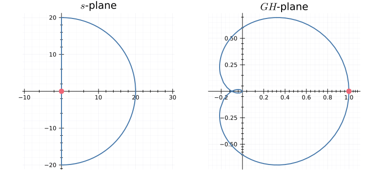{.anim .anim-small}

::: {.caption}
Nyquist plot for $K = 1$. It meets the real axis at $-0.1$, $0$, and $1$.
:::
:::

::: {.column width="45%"}
$P = 0$, so stability needs $N = 0$.

::: {.compact}
| Location of $-1/K$ | $K$ | $N$ | Stable? |
|:--:|:--:|:--:|:--:|
| [$\left(-∞, -\tfrac{1}{10}\right)$]{.fragment data-fragment-index="1"} | [$(0, 10)$]{.fragment data-fragment-index="1"} | [$0$]{.fragment data-fragment-index="2"} | [Yes]{.fragment data-fragment-index="3"} |
| [$\left(-\tfrac{1}{10}, 0\right)$]{.fragment data-fragment-index="4"} | [$(10, ∞)$]{.fragment data-fragment-index="4"} | [$2$]{.fragment data-fragment-index="5"} | [No]{.fragment data-fragment-index="6"} |
| [$(0, 1)$]{.fragment data-fragment-index="7"} | [$(-∞, -1)$]{.fragment data-fragment-index="7"} | [$1$]{.fragment data-fragment-index="8"} | [No]{.fragment data-fragment-index="9"} |
| [$(1, ∞)$]{.fragment data-fragment-index="10"} | [$(-1, 0)$]{.fragment data-fragment-index="10"} | [$0$]{.fragment data-fragment-index="11"} | [Yes]{.fragment data-fragment-index="12"} |
:::

::: {.fragment data-fragment-index="13"}
Stable for $K \in (0, 10)$ or $K \in (-1, 0)$.
:::
:::
:::

## Example 4: slide the critical point $-1/K$

::: {.columns}
::: {.column width="42%"}
$$ GH(s) = \frac{6K}{(s + 1)(s + 2)(s + 3)} $$

```{ojs}
viewof crit4 = gainSlider(gainExamples.ex4)
```

```{ojs}
gainReadout(gainExamples.ex4, crit4)
```
:::

::: {.column width="58%"}
```{ojs}
gainPlot(gainExamples.ex4, crit4)
```

[Nyquist plot of $L$ (that is, $K = 1$); the red $+$ is $-1/K$.]{.plot-legend}
:::
:::


## Example 5

::: {.columns}
::: {.column width="55%"}
$$ GH(s) = \frac{K(s - 1)}{(s + 2)(s^2 - s + 1)} $$

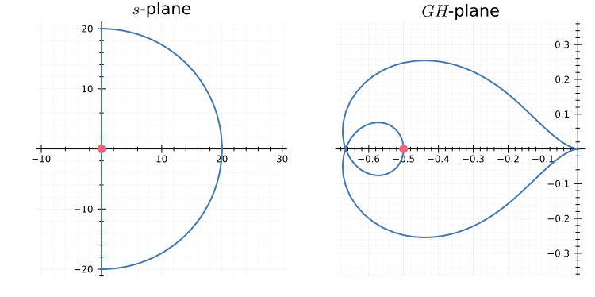{.anim .anim-small}

::: {.caption}
Nyquist plot for $K = 1$. It meets the real axis at $-2/3$, $-1/2$, and $0$.
:::
:::

::: {.column width="45%"}
The roots of $s^2 - s + 1$ are $(1 ± j\sqrt 3)/2$, so $P = 2$ and stability needs $N = -2$.

::: {.compact}
| Location of $-1/K$ | $K$ | $N$ | Stable? |
|:--:|:--:|:--:|:--:|
| [$\left(-∞, -\tfrac 23\right)$]{.fragment data-fragment-index="1"} | [$(0, 1.5)$]{.fragment data-fragment-index="1"} | [$0$]{.fragment data-fragment-index="2"} | [No]{.fragment data-fragment-index="3"} |
| [$\left(-\tfrac 23, -\tfrac 12\right)$]{.fragment data-fragment-index="4"} | [$(1.5, 2)$]{.fragment data-fragment-index="4"} | [$-2$]{.fragment data-fragment-index="5"} | [Yes]{.fragment data-fragment-index="6"} |
| [$\left(-\tfrac 12, 0\right)$]{.fragment data-fragment-index="7"} | [$(2, ∞)$]{.fragment data-fragment-index="7"} | [$-1$]{.fragment data-fragment-index="8"} | [No]{.fragment data-fragment-index="9"} |
| [$(0, ∞)$]{.fragment data-fragment-index="10"} | [$(-∞, 0)$]{.fragment data-fragment-index="10"} | [$0$]{.fragment data-fragment-index="11"} | [No]{.fragment data-fragment-index="12"} |
:::

::: {.fragment data-fragment-index="13"}
Stable only for $K \in (1.5, 2)$.
:::
:::
:::

## Example 5: slide the critical point $-1/K$

::: {.columns}
::: {.column width="42%"}
$$ GH(s) = \frac{K(s - 1)}{(s + 2)(s^2 - s + 1)} $$

```{ojs}
viewof crit5 = gainSlider(gainExamples.ex5)
```

```{ojs}
gainReadout(gainExamples.ex5, crit5)
```
:::

::: {.column width="58%"}
```{ojs}
gainPlot(gainExamples.ex5, crit5)
```

[Nyquist plot of $L$ (that is, $K = 1$); the red $+$ is $-1/K$.]{.plot-legend}
:::
:::


## Poles on the $jω$-axis {.divider .center}

## Poles on the $jω$-axis

Cauchy's argument principle requires that the contour **not pass through a pole**. This fails when $GH$ has a pole on the $jω$-axis, e.g.,
$$ GH(s) = \frac{1}{s(s + 1)}. $$

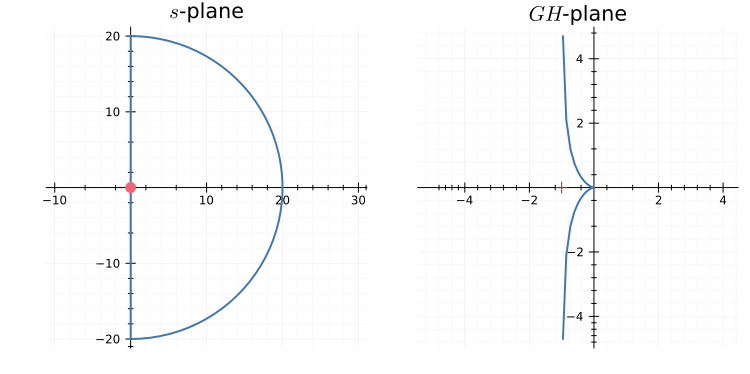{.anim .anim-small}

::: {.fragment .center-block}
Here $P = 0$, so stability needs $N = 0$. But the plot is **not closed**, so we cannot count encirclements of $-1$.
:::

## Indent the contour around the pole

Skip the pole at the origin along a small semicircle $s = r e^{jθ}$, $θ \in [-90^∘, 90^∘]$, and let $r \to 0$.

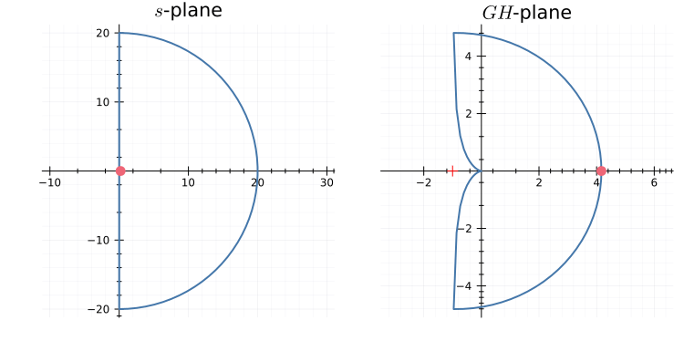{.anim .anim-small}

::: {.caption}
The indentation has radius $r = 0.2$, which is not visible at this scale.
:::

::: {.fragment .center-block}
Standard software does **not** draw this part of the plot. We need to close the plot by hand.
:::

## Closing the plot by hand

On the small semicircle $s = r e^{jθ}$, we have $GH(r e^{jθ}) = \dfrac{1}{r e^{jθ}(1 + r e^{jθ})} ≈ \dfrac{1}{r} e^{-jθ}$.

::: {.columns}
::: {.column width="48%"}
::: {.compact}
| $θ$ | $-90^∘$ | $-45^∘$ | $0^∘$ | $45^∘$ | $90^∘$ |
|:--|:--:|:--:|:--:|:--:|:--:|
| $\lvert GH(re^{jθ}) \rvert$ | $1/r$ | $1/r$ | $1/r$ | $1/r$ | $1/r$ |
| $\angle GH(re^{jθ})$ | $90^∘$ | $45^∘$ | $0^∘$ | $-45^∘$ | $-90^∘$ |
:::

::: {.fragment}
- The indentation maps to a **clockwise** arc of radius $1/r \to ∞$ through the RHP.
- No encirclement of $-1$, so $N = 0$, $Z = 0$, and the closed loop is [stable]{.text-success}.
:::
:::

::: {.column width="52%"}
```{ojs}
indentationDiagram({num: [1], den: [1, 1, 0]}, 0.25, invalidation)
```

[Left: $s$-plane near the pole. Right: $GH$-plane for $r = 0.25$. Orange: the small semicircle and its image; labels give $θ$.]{.plot-legend}

```{ojs}
//| output: false
indentOrange = "#e8710a"

// Two panels: the indentation s = r e^{jθ} around a pole at the origin, and its image under G.
// A red dot (as in the notes' animations) sweeps the small semicircle from θ = −90° to 90°,
// pauses, and repeats; its image moves along the arc in the GH-plane. The plots are drawn
// once and only the dots and the θ label are moved, by a timer cleared on invalidation.
indentationDiagram = (G, r, invalidation) => {
  const deg = Math.PI / 180
  const thetas = [-90, -45, 0, 45, 90]
  const lbl = t => `${t < 0 ? "−" : ""}${Math.abs(t)}°`
  const sOf = t => [r * Math.cos(t * deg), r * Math.sin(t * deg)]
  const tri = (z, dz) => ({re: z[0], im: z[1], rot: 90 - Math.atan2(dz[1], dz[0]) / deg})
  const axes = [Plot.ruleX([0], {stroke: "#adb5bd"}), Plot.ruleY([0], {stroke: "#adb5bd"})]
  const style = {fontSize: "12px", background: "transparent"}
  // The moving dot is the only mark filled with this red; Quarto's Plot (0.6.11) has no className option
  const movingRed = "#ee6677"
  const movingDot = z => [Plot.dot([z], {fill: movingRed, stroke: "white", strokeWidth: 1.5, r: 7})]

  // s-plane: jω-axis pieces of the contour (blue) and the indentation (orange)
  const A = 0.4
  const sArc = d3.range(-90, 90.5, 1).map(t => { const z = sOf(t); return {re: z[0], im: z[1]} })
  const sPlot = Plot.plot({
    width: 250, aspectRatio: 1, x: {domain: [-A, A], label: null, ticks: 0},
    y: {domain: [-A, A], label: null, ticks: 0}, style,
    marks: [
      ...axes,
      Plot.line([[0, -A], [0, -r]], {stroke: nyquistBlue, strokeWidth: 2.5}),
      Plot.line([[0, r], [0, A]], {stroke: nyquistBlue, strokeWidth: 2.5}),
      Plot.dot([[0, -(A + 2 * r) / 3], [0, (A + 2 * r) / 3]], {symbol: "triangle", fill: nyquistBlue, r: 6}),
      Plot.line(sArc, {x: "re", y: "im", stroke: indentOrange, strokeWidth: 2.5}),
      Plot.dot([-67.5, 67.5].map(t => tri(sOf(t), [-Math.sin(t * deg), Math.cos(t * deg)])),
               {x: "re", y: "im", rotate: "rot", symbol: "triangle", fill: indentOrange, r: 6}),
      Plot.dot([[0, 0]], {symbol: "times", stroke: "black", strokeWidth: 2, r: 6}),
      Plot.dot(thetas.map(sOf), {fill: indentOrange, r: 4}),
      Plot.text(thetas.map(t => ({z: sOf(t), t})), {
        x: d => Math.abs(d.t) === 90 ? -0.09 : d.z[0] * 1.45,
        y: d => Math.abs(d.t) === 90 ? d.z[1] : d.z[1] * 1.45, text: d => lbl(d.t), fill: "#495057"}),
      Plot.text([[A, -A]], {text: ["s-plane"], textAnchor: "end", dx: -4, dy: -8, fill: "#6c757d"}),
      ...movingDot(sOf(-90)),
      Plot.text([[-A, A]], {text: [`θ = ${lbl(-90)}`], textAnchor: "start", dx: 4, dy: 10,
                            fontSize: 14, fill: "#212529"})
    ]
  })

  // GH-plane: the software Nyquist plot (blue) and the image of the indentation (orange)
  const {pos, neg} = nyquistData(G, {wmin: r, wmax: 1e3, n: 1500})
  const gArc = d3.range(-90, 90.5, 1).map(t => { const z = tfval(G, sOf(t)); return {re: z[0], im: z[1]} })
  const gOf = t => tfval(G, sOf(t))
  const gTan = t => { const a = gOf(t + 0.01), b = gOf(t - 0.01); return [a[0] - b[0], a[1] - b[1]] }
  const gPlot = Plot.plot({
    width: 280, aspectRatio: 1, x: {domain: [-1.8, 4.2], label: null, ticks: 4},
    y: {domain: [-4.6, 4.6], label: null, ticks: 5}, style,
    marks: [
      ...axes,
      Plot.line(neg, {x: "re", y: "im", stroke: nyquistBlue, strokeWidth: 2, strokeDasharray: "6,4", strokeOpacity: 0.7}),
      Plot.line(pos, {x: "re", y: "im", stroke: nyquistBlue, strokeWidth: 2.5}),
      Plot.dot([arrowAt(G, 0.6), arrowAt(G, -0.6)], {x: "re", y: "im", rotate: "rot", symbol: "triangle", fill: nyquistBlue, r: 6}),
      Plot.line(gArc, {x: "re", y: "im", stroke: indentOrange, strokeWidth: 2.5}),
      Plot.dot([-67.5, 67.5].map(t => tri(gOf(t), gTan(t))),
               {x: "re", y: "im", rotate: "rot", symbol: "triangle", fill: indentOrange, r: 6}),
      Plot.dot(thetas.map(gOf), {fill: indentOrange, r: 4}),
      Plot.text(thetas.map(t => ({z: gOf(t), t})), {
        x: d => d.z[0] + 0.55 * d.z[0] / Math.hypot(...d.z), y: d => d.z[1] + 0.55 * d.z[1] / Math.hypot(...d.z),
        text: d => lbl(d.t), fill: "#495057"}),
      Plot.dot([[-1, 0]], {symbol: "plus", stroke: criticalRed, strokeWidth: 3, r: 7}),
      Plot.text([[4.2, -4.6]], {text: ["GH-plane"], textAnchor: "end", dx: -4, dy: -8, fill: "#6c757d"}),
      ...movingDot(gOf(-90))
    ]
  })
  const sDot = sPlot.querySelector(`g[fill="${movingRed}"] circle`)
  const gDot = gPlot.querySelector(`g[fill="${movingRed}"] circle`)
  const label = [...sPlot.querySelectorAll("text")].find(t => t.textContent.startsWith("θ ="))
  if (sDot && gDot) {
    const place = (dot, plot, z) => {
      dot.setAttribute("cx", plot.scale("x").apply(z[0]))
      dot.setAttribute("cy", plot.scale("y").apply(z[1]))
    }
    const frames = [...Array(10).fill(-90), ...d3.range(-90, 90.5, 2), ...Array(20).fill(90)]
    let i = 0
    const timer = setInterval(() => {
      const t = frames[i]
      i = (i + 1) % frames.length
      place(sDot, sPlot, sOf(t))
      place(gDot, gPlot, gOf(t))
      if (label) label.textContent = `θ = ${lbl(t)}`
    }, 50)
    if (invalidation) invalidation.then(() => clearInterval(timer))
  }
  return html`<div style="display: flex; gap: 16px; justify-content: center; align-items: center">${sPlot}${gPlot}</div>`
}
```
:::
:::

## Example 6

::: {.columns}
::: {.column width="55%"}
$$ GH(s) = \frac{K}{s(s + 1)(2s + 1)} $$

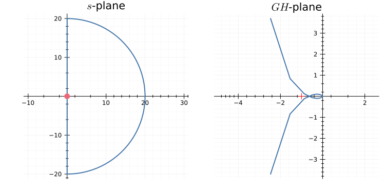{.anim .anim-small}

::: {.caption}
Nyquist plot for $K = 1$. It meets the real axis at $0$ and $-2/3$.
:::
:::

::: {.column width="45%"}
Find the values of $K$ for which the closed loop is stable.

::: {.fragment}
- $P = 0$, so stability needs $N = 0$.
- The pole at the origin means that we must first **close the plot**.
:::
:::
:::

## Example 6: closing the plot

On $s = r e^{jθ}$,
$$ GH(r e^{jθ}) = \frac{K}{r e^{jθ}(r e^{jθ} + 1)(2 r e^{jθ} + 1)} ≈ \frac{K}{r} e^{-jθ}. $$

::: {.columns}
::: {.column width="45%"}
::: {.compact}
| $θ$ | $\lvert GH \rvert$ | $\angle GH$ |
|:--:|:--:|:--:|
| $-90^∘$ | $K/r$ | $90^∘$ |
| $-45^∘$ | $K/r$ | $45^∘$ |
| $0^∘$ | $K/r$ | $0^∘$ |
| $45^∘$ | $K/r$ | $-45^∘$ |
| $90^∘$ | $K/r$ | $-90^∘$ |
:::

The two arms are joined by a **clockwise** semicircle at infinity.
:::

::: {.column width="55%"}
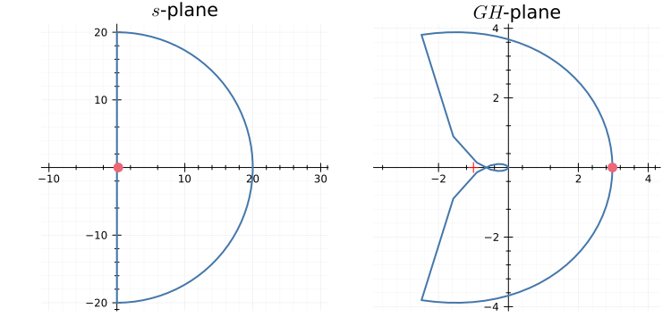{.anim .anim-small}
:::
:::

## Example 6: values of $K$

::: {.columns}
::: {.column width="55%"}
$$ GH(s) = \frac{K}{s(s + 1)(2s + 1)} $$

{.anim .anim-small}

::: {.caption}
Closed Nyquist plot for $K = 1$. It meets the real axis at $0$ and $-2/3$.
:::
:::

::: {.column width="45%"}
$P = 0$, so stability needs $N = 0$.

::: {.compact}
| Location of $-1/K$ | $K$ | $N$ | Stable? |
|:--:|:--:|:--:|:--:|
| [$\left(-∞, -\tfrac 23\right)$]{.fragment data-fragment-index="1"} | [$(0, 1.5)$]{.fragment data-fragment-index="1"} | [$0$]{.fragment data-fragment-index="2"} | [Yes]{.fragment data-fragment-index="3"} |
| [$\left(-\tfrac 23, 0\right)$]{.fragment data-fragment-index="4"} | [$(1.5, ∞)$]{.fragment data-fragment-index="4"} | [$2$]{.fragment data-fragment-index="5"} | [No]{.fragment data-fragment-index="6"} |
| [$(0, ∞)$]{.fragment data-fragment-index="7"} | [$(-∞, 0)$]{.fragment data-fragment-index="7"} | [$1$]{.fragment data-fragment-index="8"} | [No]{.fragment data-fragment-index="9"} |
:::

::: {.fragment data-fragment-index="10"}
The closed loop is stable for $K \in (0, 1.5)$.
:::

::: {.fragment .text-smaller data-fragment-index="11"}
Cross-check with Routh-Hurwitz: $2 s^3 + 3 s^2 + s + K$ is stable if and only if $0 < K < 3/2$.
:::
:::
:::

## Example 7

$$ GH(s) = \frac{K}{s^2 (s + 1)} $$

::: {.columns}
::: {.column width="50%"}
On $s = r e^{jθ}$,
$$ GH(r e^{jθ}) ≈ \frac{K}{r^2} e^{-j 2θ}. $$

::: {.compact}
| $θ$ | $-90^∘$ | $-45^∘$ | $0^∘$ | $45^∘$ | $90^∘$ |
|:--|:--:|:--:|:--:|:--:|:--:|
| $\angle GH$ | $180^∘$ | $90^∘$ | $0^∘$ | $-90^∘$ | $-180^∘$ |
:::

The magnitude is $K/r^2 \to ∞$, so the arms are joined by a **full clockwise circle** at infinity.
:::

::: {.column width="50%"}
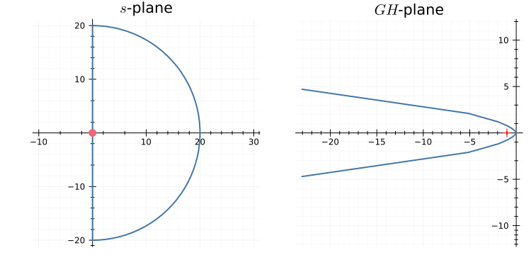{.anim .anim-small}

::: {.caption}
Nyquist plot for $K = 1$, as drawn by software.
:::
:::
:::

## Example 7: the closed plot

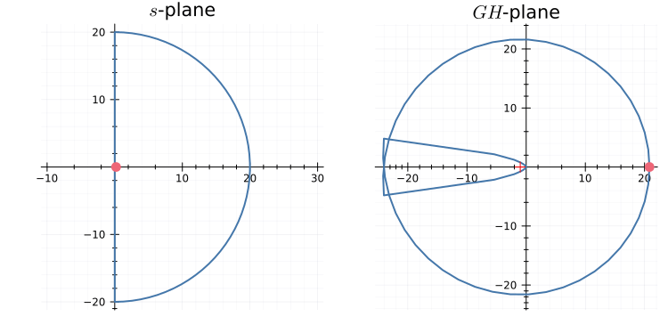{.anim}

::: {.fragment .center-block}
For every $K > 0$, $N = 2$. Since $P = 0$, $Z = N + P = 2$. [The closed loop is unstable for every $K > 0$.]{.text-danger}
:::

::: {.fragment .center-block .text-small}
Cross-check: the characteristic polynomial $s^3 + s^2 + K$ has no $s$ term, so it is not stable for any $K$.
:::

## What about other poles on the $jω$-axis?

Consider
$$ GH(s) = \frac{1}{(s^2 + 1)(s + 1)}, $$
which has poles at $±j$.

- The same idea applies. Circumvent each pole along a small semicircle of radius $r$ and let $r \to 0$.
- We will not study this case in detail in class.

## Summary

- The **Nyquist plot** of $G$ is $G(jω)$ for $ω \in (-∞, ∞)$. The part for $ω < 0$ is the mirror image of the part for $ω > 0$.
- **Cauchy's argument principle:** for a clockwise contour, $N = Z - P$.
- **Nyquist criterion:** $Z = N + P$, where $N$ counts the clockwise encirclements of $-1$ by the Nyquist plot of $GH$. The closed loop is stable if and only if $N = -P$.
- **Gain:** draw the plot for $K = 1$ and count encirclements of $-1/K$.
- **Poles on the $jω$-axis:** indent the contour. A pole of order $m$ at the origin maps to $m$ clockwise half-turns at infinity.
